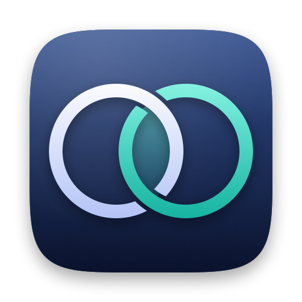

<p align="center">
  
</p>

<h1 align="center">Nodens</h1>

<p align="center">
  OpenVPN, WireGuard and Tailscale in one macOS menu-bar glyph.<br>
  Paste a configuration, click to connect, keep your tailnet working.
</p>

<p align="center">
  <a href="https://github.com/monad-wireless/nodens/actions/workflows/ci.yml"></a>
  
  <a href="LICENSE"></a>
</p>

---

Nodens is a small menu-bar app for people who need a classic VPN and a
Tailscale tailnet at the same time: a university or company VPN for one job,
the tailnet for everything else.

On macOS the two get in each other's way. A full-tunnel VPN can leave
Tailscale's own encrypted traffic without a route, and both programs try to
own DNS. Nodens runs the VPN itself and repairs the routes and DNS around
it, so both stay usable.

> **Status: pre-release (0.1.0).** The DNS handling with Tailscale was
> measured live with a pre-release build. The OpenVPN and WireGuard drivers
> pass the unit tests and the root-hook dry runs, but have not yet completed
> a live connect. See [CHANGELOG.md](CHANGELOG.md).

## Features

- **One glyph, two rings.** Left ring: Tailscale. Right ring: your VPN.
  Faint means off, a dot means changing, filled means on.
- **OpenVPN and WireGuard profiles.** Paste an `.ovpn` or a wg-quick `.conf`
  file. Nodens checks it before anything runs as root.
- **Tailscale profiles.** Switch tailnets and bring Tailscale up or down from
  the same menu.
- **Coexistence with Tailscale.** While a VPN is up, tailnet names keep
  resolving, and a route fix keeps Tailscale's traffic out of the VPN.
- **No VPN code of its own.** The packets go through proven open-source
  engines: `openvpn` and `wg-quick` with `wireguard-go`.
- **Everything reversible.** Every change Nodens makes as root is recorded and
  undone at disconnect. After a crash or a reboot, one click (or the next
  connect) undoes what is left.
- **Import from Tunnelblick.** Your existing configurations come across in one
  click.

## The menu-bar glyph

| Glyph | Meaning |
|---|---|
|  | Nothing connected. |
|  | Tailscale on, VPN off. |
|  | VPN on, Tailscale off. |
|  | Both on. |
|  | A ring is changing: connecting, disconnecting or switching. |
|  | Open the menu: the last action failed, the DNS check failed, or a crashed tunnel left changes behind. |

## Requirements

- macOS 14 or later, with Xcode. The package declares Swift tools 5.10;
  development and testing so far used Xcode with Swift 6.4.
- For OpenVPN profiles: `brew install openvpn`, or Tunnelblick's bundled copy.
- For WireGuard profiles: `brew install wireguard-tools wireguard-go bash`.
- For Tailscale: the Tailscale app with its CLI (`tailscale`).

## Install

There are no binary releases yet. Build from source:

```sh
git clone https://github.com/monad-wireless/nodens.git
cd nodens
make install
```

`make install` runs the tests, builds `Nodens.app`, copies it to
`~/Applications` and starts it. The build is signed ad hoc. If you have an
Apple Development identity, sign with it, so the Keychain and macOS keep
their permissions across rebuilds:

```sh
make install SIGN_IDENTITY="Apple Development"
```

## Usage

1. Click the glyph and open **Profiles & Settings…**.
2. Choose **New profile → OpenVPN profile** or **WireGuard profile**, give it a
   name, and paste the configuration file. Or click **Import from Tunnelblick**.
3. Read the check below the editor. It lists the server, problems that block
   a connect, and what Nodens ignores.
4. For an OpenVPN server that asks for a login, enter the username and
   password. The password goes to the Keychain.
5. Save. The profile now appears in the menu. Click it to connect.

Each connect asks for your administrator password once, because the engines
must run as root. OpenVPN disconnects need no password. WireGuard disconnects
ask again.

## How it works

Nodens owns the profiles, routes and DNS. The engines carry the packets.

- **OpenVPN:** one admin prompt installs a sanitized copy of the configuration
  and starts `openvpn` as a root daemon, held until Nodens is ready. Nodens then
  talks to it over its management port on 127.0.0.1: it releases the hold,
  answers the login from the Keychain and reads the state.
- **WireGuard:** one admin prompt installs a sanitized copy of the
  configuration and runs `wg-quick up`.
- **The root hook** (`Resources/nodens-hook`, POSIX sh) runs when a tunnel
  comes up and goes down. For a full tunnel it adds the Tailscale route fix
  and turns off IPv6 on the uplink, so no traffic bypasses the VPN. It writes
  `/etc/resolver` files for the VPN's own domains, and records each change so
  it can undo it.
- **Tailscale** keeps working: Nodens writes `/etc/resolver` files for the
  tailnet's domains and takes Tailscale out of the default DNS slot while a
  VPN is up. It puts it back when the last tunnel goes down.

Details: [docs/ARCHITECTURE.md](docs/ARCHITECTURE.md) and
[docs/TAILSCALE.md](docs/TAILSCALE.md).

## Security

Nodens starts programs as root, so it treats every pasted file as hostile:

- The configuration checks fail closed. Any control character, any quoted or
  escaped OpenVPN option name, any unknown WireGuard key, or any non-key inline
  block makes the file unusable.
- Directives that would run code or write files as root are removed:
  `up`, `plugin`, `script-security`, `PostUp`, `SaveConfig` and the rest.
- Root copies of configurations exist only while their tunnel runs.

Read [SECURITY.md](SECURITY.md) for the threat model and how to report a
vulnerability.

## Documentation

| Document | Content |
|---|---|
| [docs/ARCHITECTURE.md](docs/ARCHITECTURE.md) | Modules, drivers, the connect sequences, the root hook, the policies |
| [docs/TAILSCALE.md](docs/TAILSCALE.md) | Why a full-tunnel VPN breaks Tailscale on macOS, and the fixes |
| [docs/TROUBLESHOOTING.md](docs/TROUBLESHOOTING.md) | Logs, leftover changes, uninstalling |
| [CONTRIBUTING.md](CONTRIBUTING.md) | Building, testing, the rules for root code |
| [SECURITY.md](SECURITY.md) | Threat model and vulnerability reports |

## Limitations

- VPN DNS applies only to the VPN's own domains: those the OpenVPN server
  pushes, or those on a WireGuard `DNS` line. Nodens is not a privacy VPN
  client that sends every name through the tunnel.
- Configurations must carry keys and certificates inline.
- Private keys with a passphrase and one-time-password logins are not
  supported yet.
- Connect through Nodens. A tunnel started by another app gets none of the fixes.

## The name

In Lovecraft's Dreamlands, Nodens, Lord of the Great Abyss, is the rare kind
elder god who guides lost travellers home. There is also a node in his name.

## License

[MIT](LICENSE) © 2026 Jakub Dubec
